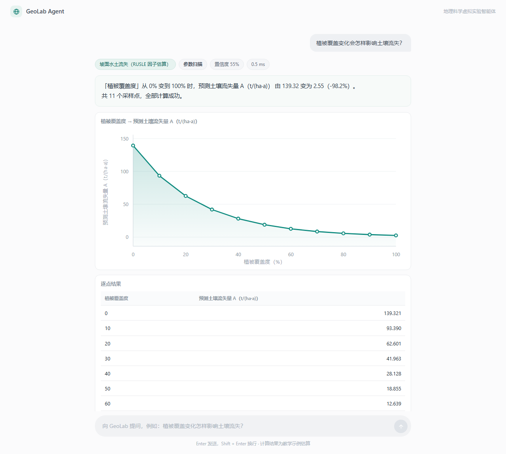
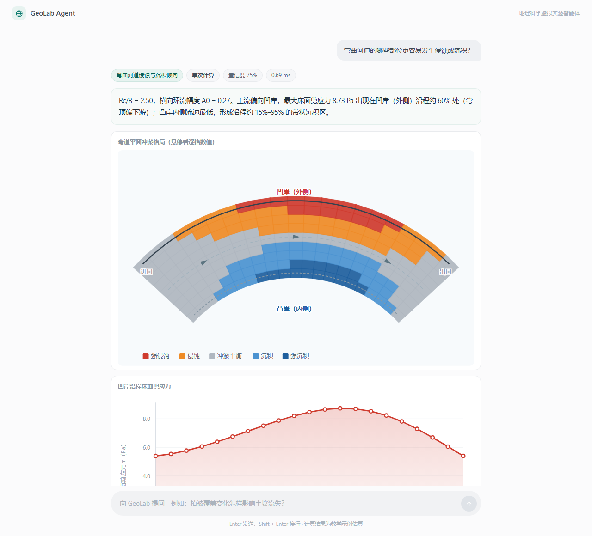

# GeoLab Agent

> 地理科学虚拟实验智能体 — 让 AI 承担**实验设计、工具调用、结果核验与解释**，而不是把它变成会说话的地理图册。

GeoLab Agent 是一个面向中学与高校地理教学的探究式虚拟实验系统。学生用自然语言提出一个问题，智能体把问题拆成变量方案，调用专业计算工具，返回可复现的数值、图表和带边界的解释。

- 计算内核：纯 Python 标准库，**零第三方依赖**
- 交互界面：原生 HTML/CSS/JS，**无框架、无 CDN、可离线**
- 启动方式：`python run.py`，不需要 pip、不需要 Docker、不需要 API Key

---

## 界面

提问即开始。四张示例卡对应四种探究方式，也可以直接输入自己的问题。


单因子扫描：结论先给，图在后，公式可以逐项核对。



弯道冲淤格局：逐格可悬停查看流速、剪应力与倾向分类。



措施对照：基准组与各方案的差距一目了然。


---

## 它做什么，不做什么

这个区分是项目的第一原则，写在文档最前面：

| ✅ 它是 | ❌ 它不是 |
|---|---|
| 坡面多年平均流失量的**教学示例估算** | 实时侵蚀预报、工程设计依据 |
| 弯道冲淤倾向的**规则化概念模型** | 二维水沙数值模型、河床演变预测 |
| 让 AI 学会「先设计对照，再算数」 | 让 AI 编造一个看起来合理的地理数字 |
| 结果附带假设、单位、适用范围的工具 | 给出一个孤立数字就结束的聊天机器人 |

之所以反复强调，是因为地理类 AI 项目最容易犯的错，就是把可视化演示包装成科学预测。本项目把「模型的边界」当作一等公民：**每一次计算返回的结果里，都强制携带 `assumptions` 与 `limitations` 字段**，任何下游（界面、报告、大模型）都绕不过去。

---

## 30 秒跑起来

```bash
git clone https://github.com/Yvonna-hoo/GeoLab-Agent.git
cd GeoLab-Agent
python run.py
```

打开 <http://127.0.0.1:8010>。就这样，没有第二步。

要求 Python ≥ 3.8，其它什么都不用装。

```bash
python run.py --host 0.0.0.0 --port 8080   # 局域网内让别人也能看你的演示
python -m unittest discover -s tests       # 跑测试（61 项）
```

### 接入大模型（可选）

不配置也能跑完整流程——规则式路由兜底。要接入大模型：

```bash
copy .env.example .env        # macOS/Linux: cp .env.example .env
# 编辑 .env，填入 GEO_API_BASE / GEO_API_KEY / GEO_MODEL
python scripts/check_key.py   # 验证 key，只打印状态与用量，不打印完整 key
```

`.env` 已在 `.gitignore` 中，不会进入仓库。

任何 OpenAI 兼容服务都能直接换：DeepSeek、阿里云百炼、联通元景、上海智慧教育平台——
只改三个环境变量，代码一行不动。

**三种引擎策略**（`POST /api/agent/route` 的 `engine` 字段）：

| 取值 | 行为 |
|---|---|
| `auto`（默认） | 配了 key 就走大模型；调用失败时**静默回退**规则引擎 |
| `llm` | 强制走大模型，失败才回退 |
| `rule` | 强制走规则引擎，用于基线与离线演示 |

返回里的 `engine` 字段会如实说明这次是谁答的，界面右上角也会显示当前模式。
回退不是隐藏失败，而是让「能答」优先于「答得漂亮」。

两个引擎的实测对比见 **[docs/ENGINE_COMPARISON.md](docs/ENGINE_COMPARISON.md)**：

| 任务集 | 规则引擎 | 大模型 |
|---|---|---|
| A · 设计同源（18 条，规则引擎据此调优） | 100% | 100% |
| B · 未见过的新问法（12 条） | **33.3%** | **91.7%** |

A 集的 100% 是过拟合的必然结果，B 集才是真实能力。所以两者不是二选一，
而是**规则兜底 + 模型泛化**——这也是 `auto` 成为默认策略的原因。


---

## 两个实验模块

### 1. 坡面水土流失（RUSLE 因子框架）

```
A = R · K · LS · C · P
```

| 因子 | 含义 | 本项目的处理 |
|---|---|---|
| R | 降雨侵蚀力 | 用户给定，附气候带量级参考 |
| K | 土壤可蚀性 | 用户给定，附质地分类参考 |
| LS | 坡度坡长因子 | Renard et al. 1997：`L=(λ/22.13)^m`，`m=β/(1+β)`；S 用 McCool 1987，陡坡段切 Nearing 1997 |
| C | 覆盖管理因子 | **两种方式**：由覆盖度按 `C=exp(-decay×覆盖%)` 估算（承认这是简化假设），或直接给定实测 C 因子 |
| P | 保持措施因子 | 五种措施的典型中值，可改 |

输出按《土壤侵蚀分类分级标准》SL 190-2007 给出水力侵蚀强度等级（微度/轻度/中度/强烈/极强烈/剧烈）。

### 2. 弯曲河道侵蚀与沉积倾向

规则化弯道模型，核心是一条可解释的因果链：

```
弯道离心作用 → 横向环流 → 主流偏向凹岸 → 凹岸剪应力↑、凸岸剪应力↓ → 凹岸冲刷、凸岸淤积
```

- 横向流速剖面：`v/v̄ = 1 + A(φ)·(2s−1)`，`s` 从凸岸 0 到凹岸 1
- 环流幅度：`A0 = clamp(0.15 + 0.5/(Rc/B), 0.05, 0.50)`，弯道越急越强
- 沿程包络：`sin(π·t^1.4)`，峰值落在**弯顶偏下游**（与观测认识一致）
- 床面剪应力：`τ = ρ·(f/8)·v²`
- 冲淤判据：`τ/τc`（是否真的能冲起来）＋ `v/v̄`（流速偏向哪一侧）

模型会明确区分两件事——**流速偏向凹岸**（运动学）和**剪应力超过起动条件**（动力学）。二者不一定同时成立，这是学生最容易混淆的地方。

---

## 四种探究模式

同一个工具，四种问法：

| 模式 | 学生怎么问 | 工具怎么做 |
|---|---|---|
| `run` | 「大概多少？」 | 单点计算 |
| `sweep` | 「会怎样变？」 | 单参数扫描，出对照曲线 |
| `compare` | 「哪个方案更好？」 | 基准组 vs 对照组，出增减百分比 |
| `analyze` | 「哪个因子最关键？」 | 数值弹性系数 `d(lnY)/d(lnX)` 并排序 |

`analyze` 用中心差分算弹性系数，不依赖解析求导，因此**对任何新接入的实验都自动可用**——这是可复用性的一个具体体现。

---

## 设计要点

### 参数校验是一道闸门，不是装饰

所有数值由工具计算，模型无权编造。参数越界时工具**拒绝执行**并返回结构化错误：

```json
{
  "ok": false,
  "errors": [{
    "field": "vegetation_cover_pct",
    "code": "above_max",
    "message": "「植被覆盖度」不能大于 100%，收到 130",
    "allowed": {"min": 0, "max": 100, "unit": "%"}
  }]
}
```

`field`、`code`、`allowed` 都是给程序读的，大模型可以据此自我修正后重试。界面上可以直接演示这个拒绝过程——把覆盖度输成 130%，看工具把请求挡回来。

### 新增一个实验只需要改两个地方

1. 写一个 `Experiment` 子类，声明 `parameters`、`assumptions`、`limitations`，实现 `run()`
2. 在 `geolab/registry.py` 里 `register()` 一行

前端表单、四种模式、任务路由、测试框架都会自动发现它。演示「可插拔」最快的方式就是现场加一个实验，看界面自己长出参数面板。

### 无 LLM 也能跑通全链路

`geolab/agent/router.py` 是一个规则式任务路由：关键词 + 参数抽取 + 意图判定。它有实际用处，不只是降级方案：

- 没有 API Key、没有网络的机器上，端到端链路照样完整可演示；
- 它提供了一个**可回归的基线**。接大模型后逐条比对，才能证明「加了大模型确实更好」，而不是凭感觉宣称。

---

## 目录结构

```
GeoLab-Agent/
├── run.py                      启动入口
├── geolab/
│   ├── protocol.py             统一实验协议：参数声明、结构化校验、结果封装、弹性系数
│   ├── registry.py             可插拔实验注册表
│   ├── service.py              四种执行模式（run / sweep / compare / analyze）
│   ├── server.py               标准库 HTTP 服务
│   ├── experiments/
│   │   ├── soil_erosion.py     RUSLE 水土流失
│   │   └── river_bend.py       弯道侵蚀沉积
│   └── agent/
│       ├── router.py           规则路由（关键词 + 参数抽取 + 意图正则）
│       ├── llm.py              OpenAI 兼容客户端（标准库实现）
│       └── llm_router.py       大模型路由 + 校验修复 + 失败回退
├── web/                        前端（无框架、无 CDN）
├── skills/                     EduWork / DSH 技能定义
├── scripts/check_key.py        验证模型服务配置
├── tests/                      61 项单元测试
├── eval/                       回归集、未见过的新问法集、引擎对比脚本
└── docs/                       架构、接口、模型假设、引擎对比
```

---

## 接入 EduWork

EduWork 构建在 DeepSeek Harness 之上，其「技能」就是 `SKILL.md` 目录。本项目已经按该约定写好三个技能：

| 技能 | 作用 |
|---|---|
| `geolab-experiment-design` | 把学生的问题拆成自变量/因变量/控制变量，规定结论表述规范 |
| `geolab-soil-erosion` | 水土流失工具的参数、模式、解释纪律与禁止事项 |
| `geolab-river-bend` | 弯道工具的参数、返回值读法、解释纪律 |

把 `skills/` 下的目录放入 EduWork 的技能目录即可被加载。工具的 HTTP 接口见 [docs/API.md](docs/API.md)；如需注册为 EduWork 原生工具（npm 插件），参见 [docs/ARCHITECTURE.md](docs/ARCHITECTURE.md) 的「接入路线」。

> 说明：原生插件包尚未发布。当前版本通过 HTTP 接口 + 技能定义接入，这一状态在 README 中如实标注，不夸大完成度。

---

## 测试与评测

```bash
python -m unittest discover -s tests        # 61 项，覆盖物理一致性、校验、服务层与路由
python eval/run_eval.py                     # 典型任务回归集（18 条）
python eval/compare_engines.py              # 规则 vs 大模型，两个任务集（30 条）
```

测试不只验证「函数能跑」，而是验证**关系方向**：覆盖度上升流失量必须下降、凹岸剪应力必须大于凸岸、`τ` 必须与 `v²` 成正比、断面平均流速必须守恒。任何一条方向反了，教学结论就错了。

`compare_engines.py` 会同时报告**设计同源集**和**未见过的新问法集**。只报前者是自欺欺人——那批问题本来就是照着规则引擎的关键词设计的。

---

## 路线图

- [x] 计算内核与统一协议
- [x] 两个实验模块、四种探究模式
- [x] 结构化参数校验与错误自修正接口
- [x] 前端界面与离线图表
- [x] 技能定义（SKILL.md）
- [x] 单元测试与任务回归集
- [x] 接入真实大模型（规则路由保留为兜底与基线）——见 [引擎对比](docs/ENGINE_COMPARISON.md)
- [ ] EduWork 原生插件（npm 包 `@geolab/dsh-geolab`）
- [ ] 对照实验：传统虚拟实验 / 纯聊天模型 / 本智能体 三组教学效果对比
- [ ] 地形 2.5D 剖面与等值线增强

---

## 许可

代码采用 [MIT](LICENSE)。
RUSLE 公式与 SL 190-2007 分级标准为公开的学术与国家标准文献，本项目仅实现其教学用途的简化版本。

## 致谢

- RUSLE：Wischmeier & Smith (1978)、Renard et al. (1997)、McCool et al. (1987)、Nearing (1997)
- 侵蚀分级：《土壤侵蚀分类分级标准》SL 190-2007
- 运行基座：[EduWork](https://github.com/ECNU/EduWork) / [DeepSeek Harness](https://github.com/deepseek-ai/deepseek-harness)

---

**计算结果为教学示例估算，用于理解地理过程的机理与量级，不作预测或工程依据。**
